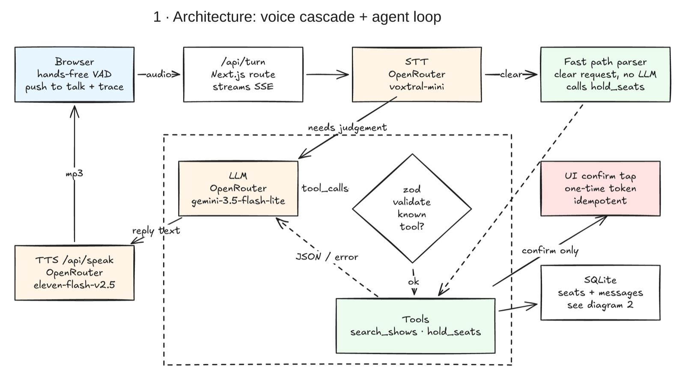
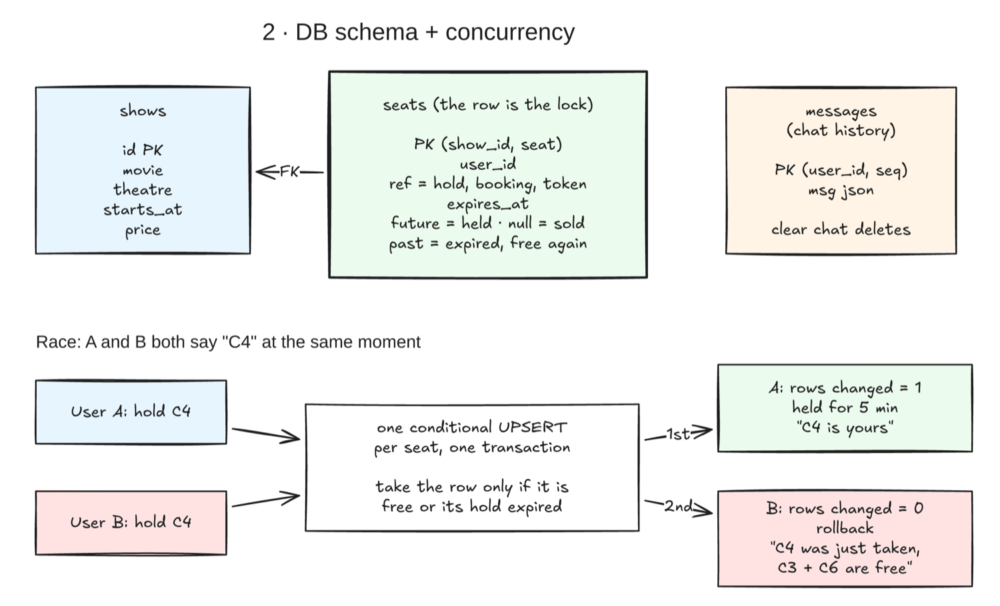

# Bookie

book movie tickets by talking.. say a movie, a day and how many seats, bookie holds the best seats for 5 minutes and one tap books them

every step shows up live in a trace panel with its timing, so nothing it does is hidden

## run it

```bash
npm install
echo "OPENROUTER_KEY=sk-or-..." > .env.local
npm run dev        # http://localhost:3001
npm test           # 5 tests
npm run bench      # latency bench, server must be running
npm run bench:vad  # VAD tuning bench
```

needs node 22+ (uses the built in `node:sqlite`) and `ffmpeg` for the bench clips

## how it works



**Figure 1.** system architecture.. a cascade, not speech to speech, so every hop is text we can validate, trace and test

- mic audio goes to `/api/turn`, which transcribes it and streams every step back as SSE
- plain requests like "two tickets for interstellar tonight" skip the model entirely (`src/lib/intent.ts`).. anything with doubt goes to the LLM
- the LLM has 2 tools, `search_shows` and `hold_seats`, with zod checked args and a step cap of 8
- the agent can only hold seats.. booking needs the user's tap and the hold ref from their own session
- hands free mode runs Silero VAD in the browser, self hosted from `/vad`, with barge in and push to talk as the manual override
- chat history is saved per session in SQLite, so a reload picks up the conversation.. clear chat deletes it



**Figure 2.** database schema and what happens when two people want the same seat.. one `seats` table, the row is the lock

- `PRIMARY KEY (show_id, seat)` means one owner per seat
- a hold is one conditional upsert per seat.. it only takes a row that is free or expired, otherwise the whole hold rolls back
- `expires_at` null means sold, so there is no separate holds or bookings table

## latency

same 5 spoken prompts, 3 runs each, ms

| stage | before p50 | now p50 | now p95 |
|---|---|---|---|
| speech to text | 1130 | 741 | 1563 |
| model calls per turn | 3 | 0 | 1 |
| release to reply text | 5535 | 970 | 4445 |
| release to first audio | 6576 | 2014 | 5517 |

most of the win is the fast path, plain requests never wait on a model.. the rest is shows in the prompt, a fixed reply after a hold, streamed audio, and faster models picked by a small bench (`voxtral-mini` for speech, `gemini-3.5-flash-lite` for the agent)

the VAD silence window is tuned on clips with known pauses, not by feel.. 700 ms is the shortest window that never cut a sentence at a 500 ms pause, and noise alone never started a turn

## tests

5 tests cover the tool contract and parser, the booking lifecycle, hold expiry, a real 8 process race on one db file (exactly one wins), and the HTTP routes end to end with scripted models, chat history included
